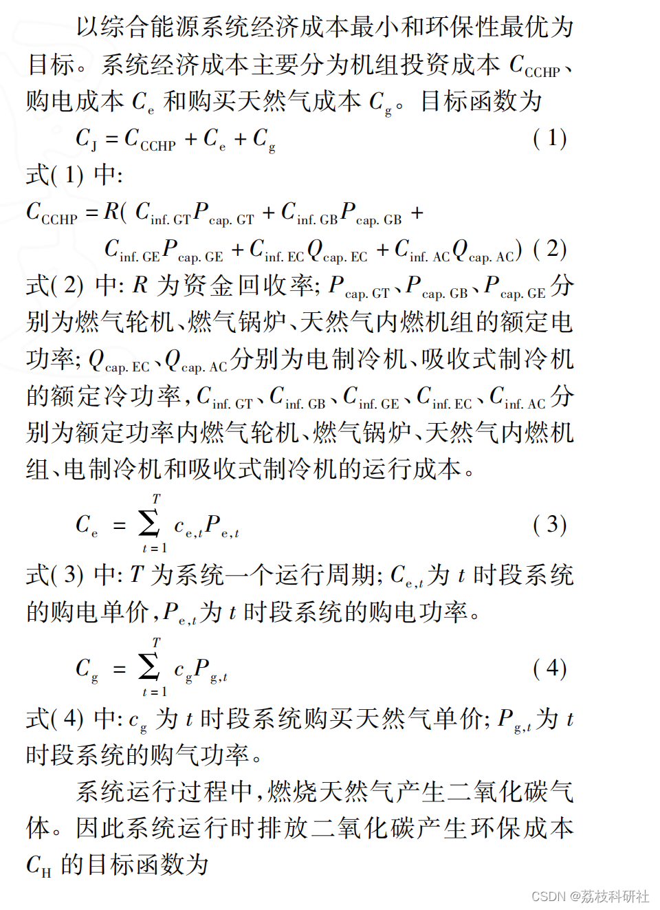
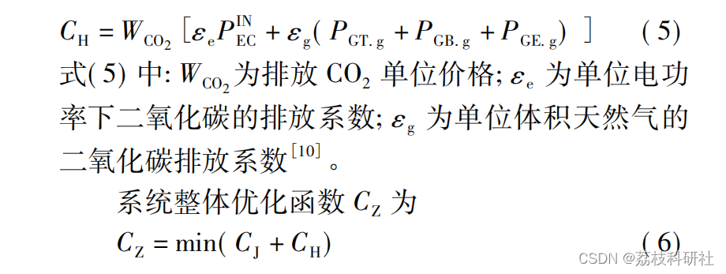
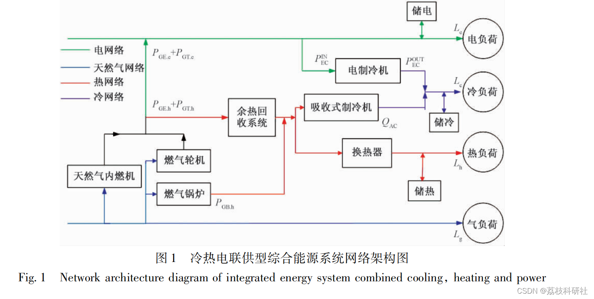
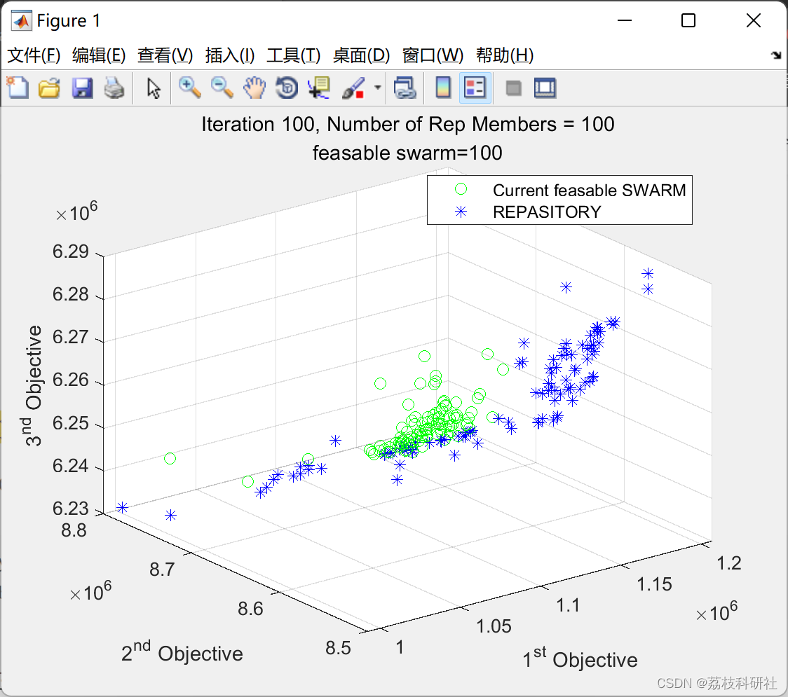
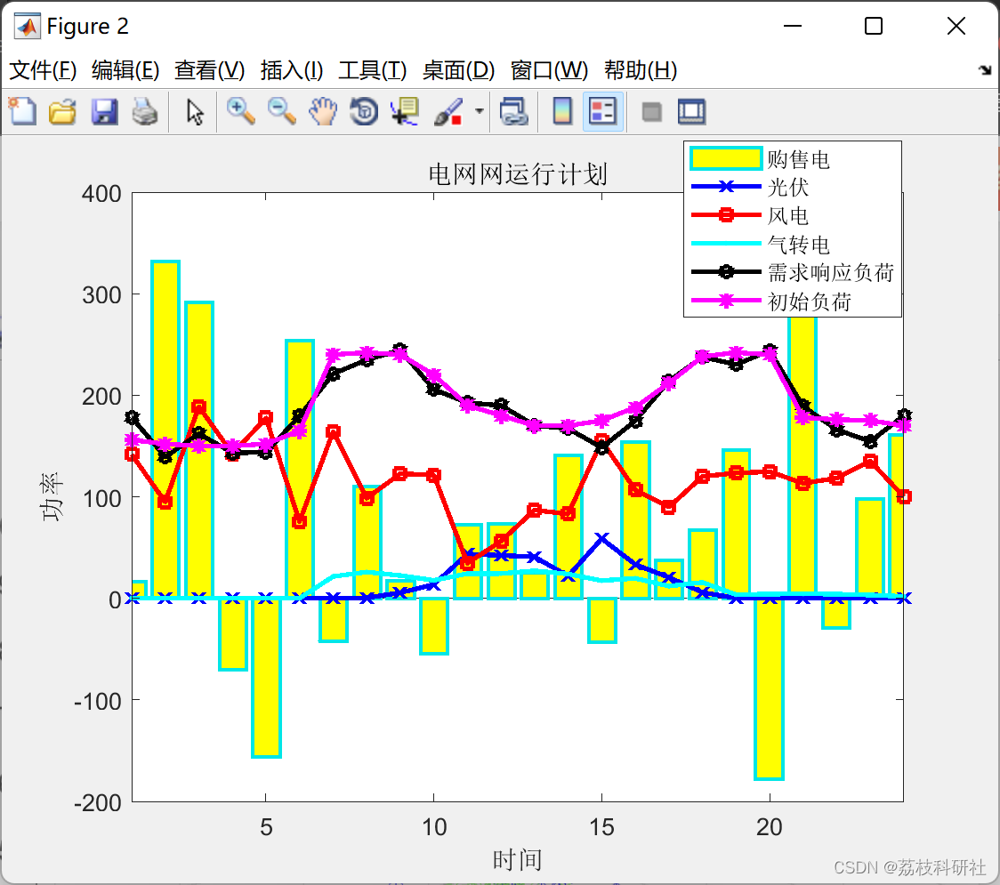
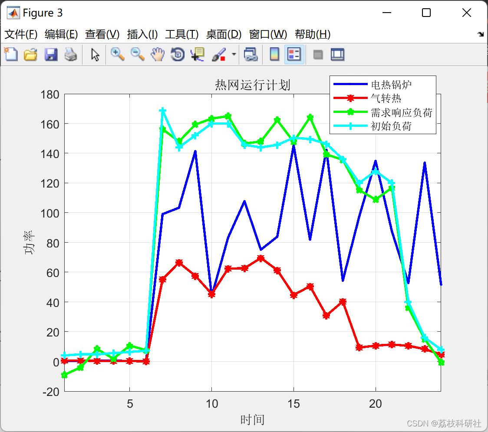
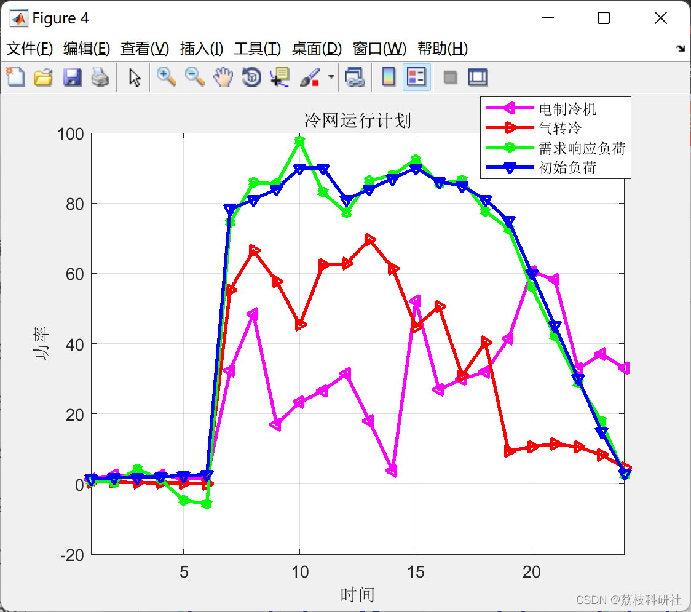

# Optimization of the Combined Energy System for Cogeneration Based on Multi-Objective Particle Swarm Optimization Algorithm (Matlab Code Implementation)

​  
Editor
Existing energy systems are often planned and operated independently, leading to low energy utilization rates and high pollution. Nowadays, people are more focused on how to optimize the independent energy systems for synergy, reduce environmental pollution while increasing energy utilization and economic performance.
The large-scale integration of various energy sources has led to the energy system often failing to balance economic and environmental aspects, resulting in insufficient optimization capabilities. Therefore, how to optimize the integrated energy system to balance its economic and environmental performance becomes a problem that needs to be addressed.
Utilize linear models to optimally configure the capacity of power, natural gas, and thermal systems, enhancing the energy efficiency of the system; literature [6-9] considers issues related to carbon emissions and the absorption of renewable energy, proposing a new hybrid power flow calculation method to ensure the economically and stably operating microgrid with combined heat and power.
1.1 Comprehensive Energy System Collaborative Optimization Objective Function Editor
Editor
1.2 Comprehensive Energy System Modeling and Constraints - The combined heat, power (CHP) comprehensive energy system is the most commonly used regional comprehensive energy system, with its network architecture shown in Figure 1.
CCHP systems can utilize natural gas internal combustion engines and gas turbines to generate electricity by burning natural gas, as well as these devices and gas.
The heat generated by the boiler is used for heating and cooling, thereby integrating power supply, heating, cooling, and gas supply. This enhances the coupling degree of various functional systems and improves the efficiency of energy utilization.
Editor
📚2 Running Results Editing
Editor
Editor
Part of the code:
function result=fitness(x,k)  
global PV;  
global WT;  
global P_load;  
global R_load;  
global L_load;  
global G_price;  
global C_grid_sell;% Selling electricity price
The following is the translation of the Chinese text into English:
Gas Price = 0.175; % Gas Price  
nGT_e = 0.29; % Gas Turbine Conversion Efficiency  
nGT_h = 0.61;  
nGB_h = 0.85; % Thermal Boiler Heat Efficiency  
nGE_e = 0.35; % Natural Gas Internal Combustion Engine Conversion Efficiency  
nGE_h = 0.7;  
COP_EC = 5; % Electric Cooling Machine's Cooling Efficiency  
COP_AC = 1.2;% Absorption Cooling Machine's Cooling Efficiency  
n_hs = 0.9;  % Waste Heat Recovery System Efficiency  
n_hr = 0.85; % Heat Exchanger Efficiency  
for j = 1:120  
if j < 25  
PGT(j) = x(j);  
elseif j > 24 && j < 49  
PGB(j-24) = x(j);  
elseif j > 48 && j < 73  
PGE(j-48) = x(j);  
elseif j > 72 && j < 97  
PEC(j-72) = x(j);  
elseif j > 96  
Grid(j-96) = x(j);  
end  
end  
PGTe = PGT * nGT_e; % Gas Turbine Conversion  
PGTh = PGT * nGT_h;  
PGBh = PGB * nGB_h; % Thermal Boiler Conversion  
PGEe = PGE * nGE_e; % Natural Gas Internal Combustion Engine Conversion  
PGEh = PGE * nGE_h;  
PE = PV' + WT' + Grid + PGTe + PGEe - PEC; % Total Electricity Generation from the Power Plant  
P_hs = (PGEh + PGTh) * n_hs + PGBh; % Heat from the Waste Heat Recovery System  
P_hr = P_hs * n_hr; % Heat Gained through the Heat Exchanger  
Q_AC = P_hs * COP_AC; % Cooling Capacity of the Absorption Cooling Machine
Q_EC=PEC*COP_EC;  
Q_all=Q_AC+Q_EC;  
sum_delt_P=0;  
sum_delt_R=0;  
sum_delt_L=0;  
delt_P=(P_load-PE);  
delt_R=(R_load-P_hr);  
delt_L=(L_load-Q_all);  
sum_delt_P=sum(delt_P);  
sum_delt_R=sum(delt_R);  
sum_delt_L=sum(delt_L);  
BT1=delt_P;  
BT2=delt_R;  
BT3=delt_L;  
SOC=0;  
dsoc=0;  
for i=1:24  
SOC=SOC+BT1(i);  
if SOC>1000  
dsoc=dsoc+(SOC-1000);  
end  
if SOC<-1000  
dsoc=dsoc+abs((SOC+1000));  
end  
end  
r1=0;  
r2=0;  
r3=0;  
if(sum_delt_P<2000)  
r1=1.0;  
elseif(sum_delt_P>2000&&sum_delt_P<=3000)  
r1=5;  
elseif(sum_delt_P>3000&&sum_delt_P<=4000)  
r1=10;  
elseif(sum_delt_P>4000&&sum_delt_P<=6000)  
r1=100;  
else  
r1=1000;  
end
if(sum_delt_R<1000)  
r2=1.0;  
elseif(sum_delt_R>1000&&sum_delt_R<=2000)  
r2=5;  
elseif(sum_delt_R>2000&&sum_delt_R<=3000)  
r2=10;  
elseif(sum_delt_R>3000&&sum_delt_R<=4000)  
r2=20;  
else  
r2=1000;  
end  
if(sum_delt_L<3000)  
r3=1.0;  
elseif(sum_delt_L>3000&&sum_delt_L<=4000)  
r3=5;  
elseif(sum_delt_L>4000&&sum_delt_L<=8000)  
r3=10;  
elseif(sum_delt_L>8000&&sum_delt_L<=10000)  
r3=50;  
else  
r3=2000;  
end  
C_all=0;  
for i=1:24  
C_PEC(i) = G_price(i) * PEC(i); % Electric refrigeration machine purchase electricity cost
if Grid(i)>0  
C_grid(i)= G_price(i)*Grid(i); %Electricity online purchase cost
else  
C_grid(i)= C_grid_sell*Grid(i); % Electricity sales revenue from the power grid
end  
end  
C_all=gas_price*(sum( PGT)+sum( PGB)+sum( PGE))+sum( C_grid)++sum( C_PEC)+0.8*sum(abs(BT1)+abs(BT2)+abs(BT3));  
% result=C_all+r1*sum_delt_P+r2*sum_delt_R+r3*sum_delt_L;  
result=C_all+10*dsoc;  
🎉3 References
🌈4 Matlab code implementation

## Images

<!-- PAYMENT_BLOCK -->

## Get this dataset

- Payment link (Stripe): [Buy now](https://buy.stripe.com/3cs8yP7sY87d0vu9AB)
- Payment QR code: 

<!-- /PAYMENT_BLOCK -->
